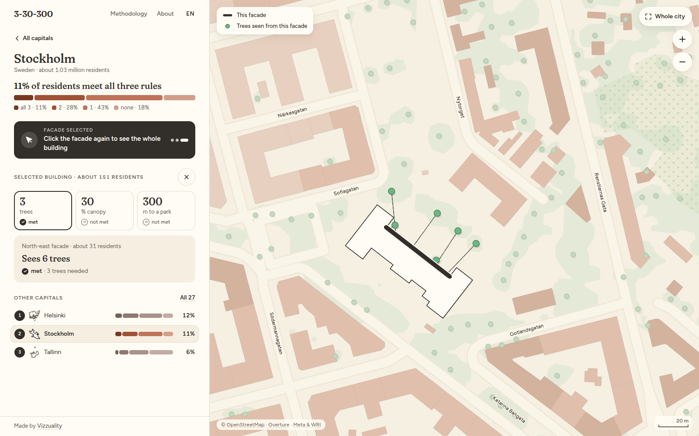

# 3-30-300 in the EU capitals

How green is your capital? The 3-30-300 rule asks for three things: every home has at least **3** trees in view, every neighbourhood has **30%** tree canopy, and every resident lives within **300 m** of a park. This site checks the rule for every home in the 27 capitals of the European Union. You can compare the capitals, then zoom into a city to see which rules each building meets, and why.



## Run it

### The site (`client/`)

A TanStack Start application (React, deck.gl), built and served with Nitro. It runs on Node.js 24 and pnpm 12, at the exact versions in `client/.nvmrc` and `client/package.json`.

```sh
cd client
nvm use        # Node.js from .nvmrc
pnpm install
pnpm dev       # http://localhost:3000
```

By default the site uses a small stand-in release in `tests/fixtures/release/`: Stockholm's real figures, and placeholders for the 26 other capitals. To use a release written by the pipeline, set `VITE_DATA_RELEASE` (its name) and `DATA_RELEASE_DIR` (its folder) in your shell.

Other commands:
- `pnpm build`, then `pnpm start`: the production server.
- `pnpm test:unit`, `pnpm test:a11y`, `pnpm test:e2e`: the tests.

The deployed site reads the release from a private storage bucket, on the server only.

### The data pipeline (`data-processing/`)

The pipeline computes each capital's layers and writes a data release: PMTiles archives and JSON files. It uses Python 3.13 with uv, Kedro and just.

```sh
cd data-processing
uv sync
uv run just install-tippecanoe
uv run just run stockholm       # one capital
uv run just run-all             # the 27 capitals, then the ranking and the Home map
uv run just check 2026-10-all   # checks a release folder
```

The largest capitals need about 13 GB of memory.

## Licence

The code is under the [MIT licence](LICENSE), Copyright (c) 2026 Vizzuality.

The licence covers the code only. Each data source keeps its own licence:

- OpenStreetMap and Overture Maps: ODbL. The data derived from them is published under the ODbL.
- The Meta and WRI canopy height map, and JRC GHS-POP: CC BY 4.0.
- Natural Earth: public domain.
- Wikidata: CC0.
